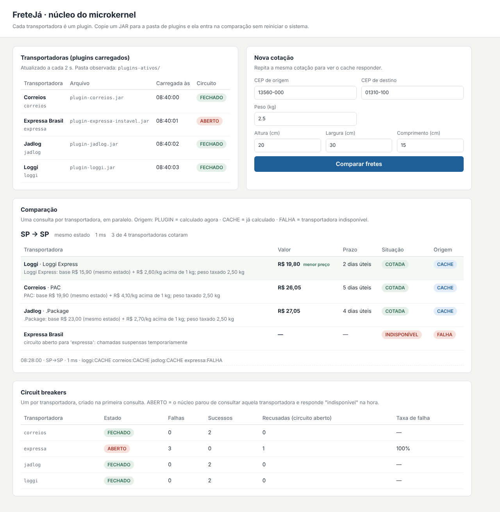

# FreteJá — Microkernel com descoberta dinâmica de plugins

Trabalho prático de Arquitetura de Software (IFSP São Carlos — Prof. Dr. Lucas Oliveira).

**Equipe:** Bruno G. A. Silva, Sabrina, Filipe

Comparador de frete para lojas virtuais: a loja informa CEP de origem, CEP de destino, peso e
dimensões do pacote, e o sistema devolve as cotações de várias transportadoras (valor e prazo),
ordenadas pelo menor preço. **Cada transportadora tem regras próprias, entra e sai com frequência e
depende de um serviço externo que pode cair** — por isso cada transportadora é um plugin.

| | |
|---|---|
| **Estilo arquitetural** | Microkernel com descoberta dinâmica de plugins |
| **Elemento adicional 1** | Circuit Breaking (Resilience4j), um circuito por transportadora |
| **Elemento adicional 2** | Caching (Redis) das cotações, por transportadora + envio |
| **Stack** | Java 21, Spring Boot 3.3, Resilience4j 2.2, Redis 7, Docker |

> As regras e os valores das transportadoras são **fictícios** e a "consulta à API" é simulada com
> uma espera de 300 a 600 ms. Não há integração real com nenhuma transportadora.



---

## Como a arquitetura aparece no código

```
freteja/
├── plugin-api/          CONTRATO — única coisa que núcleo e plugins compartilham
│   ├── Transportadora        interface: id(), nome(), cotar(Envio)
│   ├── Envio                 CEPs, peso, dimensões; distância, peso cúbico, chave de cache
│   └── CotacaoDeFrete        COTADA / NAO_ATENDE / INDISPONIVEL, valor, prazo
│
├── nucleo/              NÚCLEO — fluxo comum, não sabe calcular frete
│   ├── plugin/               descoberta dinâmica (Java puro, sem Spring)
│   │   ├── CarregadorDePlugins   observa a pasta, carrega/troca/remove JARs em execução
│   │   └── RegistroDePlugins     "quais transportadoras estão disponíveis agora?"
│   ├── execucao/
│   │   └── ExecutorIsolado       ÚNICO ponto que chama plugin: circuit breaker + tempo limite
│   ├── cotacao/
│   │   ├── ComparadorDeFrete     consulta todas em paralelo e ordena
│   │   └── CotadorDeTransportadora  cotação de uma transportadora + @Cacheable (chave com a versão do JAR)
│   ├── config/               montagem (Spring) e verificação periódica da pasta
│   └── web/                  API REST + painel em /index.html
│
└── plugins/             PLUGINS — cada um é um JAR independente
    ├── plugin-correios         PAC, até 30 kg
    ├── plugin-jadlog           mais barata para pacotes pesados, até 100 kg
    ├── plugin-loggi            a mais barata, mas só dentro do mesmo estado
    ├── plugin-expressa-instavel   API "fora do ar": trava de propósito (demonstra o circuit breaker)
    └── plugin-expressa         versão corrigida (demonstra troca de versão em execução)
```

**Como uma comparação acontece:**
1. O painel (ou a loja) envia `POST /api/cotacoes` com o envio.
2. O `ComparadorDeFrete` pega no `RegistroDePlugins` as transportadoras carregadas e dispara **uma
   thread virtual por transportadora**: a resposta demora o tempo da mais lenta, não a soma.
3. Para cada uma, o `CotadorDeTransportadora` procura no cache (`id + versão do JAR + envio`). Se não houver, chama
   o `ExecutorIsolado`, que passa pelo **circuit breaker** daquela transportadora e executa `cotar()`
   com **tempo limite de 2 s**.
4. Falha, demora ou circuito aberto viram `INDISPONIVEL` só para aquela transportadora; as outras
   aparecem normalmente.
5. O resultado volta ordenado: cotadas (menor preço, depois menor prazo), depois "não atende", depois
   indisponíveis. Cada linha informa a origem: `PLUGIN`, `CACHE` ou `FALHA`.

**Como um plugin é descoberto:** o núcleo verifica `plugins-ativos/` a cada 3 s. Para cada JAR novo,
cria um `URLClassLoader` só para ele e usa `ServiceLoader` para achar as classes que implementam
`Transportadora` (declaradas em `META-INF/services/`). JAR apagado → plugin removido. JAR substituído →
versão nova carregada e circuito zerado. Nada disso exige reiniciar.

**Como o cache acompanha os plugins:** cada JAR carregado ganha uma versão, o começo do SHA-256 do
seu conteúdo, e ela entra na chave do cache. Trocar o JAR de uma transportadora gera chaves novas só
para ela; as outras continuam saindo do cache, e as entradas antigas expiram sozinhas em 5 min. Como a
versão depende só do conteúdo, reiniciar o núcleo ou subir outra réplica encontra as mesmas chaves.

**Restrições do estilo, verificadas no build** (`ArquiteturaTest`, ArchUnit):
1. o núcleo nunca depende de uma transportadora concreta;
2. o contrato não depende do núcleo;
3. nenhuma classe fora de `execucao` chama `cotar()` de uma transportadora — toda chamada passa pelo circuit breaker;
4. o mecanismo de descoberta de plugins não depende do Spring.

---

## Como rodar

Pré-requisitos: **JDK 21** e **Maven 3.9+**. Docker é opcional.

### 1. Compilar

```bash
./scripts/build.sh
```

Compila, roda os testes, coloca todos os plugins em `plugins-disponiveis/` e ativa **Correios** e
**Jadlog** em `plugins-ativos/`.

### 2a. Rodar com Docker (núcleo + Redis)

```bash
docker compose up --build
```

> Docker Desktop no Linux: se aparecer `failed to connect to the docker API at unix:///var/run/docker.sock`,
> abra o Docker Desktop e rode `docker context use desktop-linux`.

### 2b. Rodar sem Docker (cache em memória, sem Redis)

```bash
java -jar nucleo/target/nucleo.jar --spring.profiles.active=local
```

Abra **http://localhost:8080**.

---

## Roteiro da demonstração (~5 min)

Painel aberto no navegador e um terminal ao lado. Valores com o envio padrão do painel
(São Carlos → São Paulo, 2,5 kg, 20 × 30 × 15 cm).

**1. Estado inicial.** O painel mostra *Correios* e *Jadlog*. Clique em **Comparar fretes** →
Correios R$ 26,05 (menor preço) e Jadlog R$ 27,05, origem `PLUGIN`, ~600 ms.

**2. Cache.** Clique de novo → as duas com origem `CACHE`, poucos ms.

**3. Descoberta dinâmica.** Com o sistema rodando:
```bash
./scripts/instalar.sh loggi
```
Em poucos segundos *Loggi* aparece na lista (linha destacada), com a versão do JAR. Compare de novo →
Loggi R$ 19,80 vira o **menor preço**, com origem `PLUGIN`, enquanto Correios e Jadlog continuam com
origem `CACHE`: só a transportadora nova foi consultada. Nenhum restart. Troque o destino para o Rio (`20040-020`) → Loggi responde
**NÃO ATENDE** (só entrega dentro do estado) e Jadlog passa a ser a mais barata.

**4. Circuit breaker.** Volte o destino para `01310-100` e instale a transportadora com defeito:
```bash
./scripts/instalar.sh expressa-instavel
```
Compare três vezes: cada comparação leva ~2 s (tempo limite) e a Expressa aparece **INDISPONÍVEL**,
enquanto as outras continuam cotando. Na terceira, o circuito da `expressa` fica **ABERTO**. A
quarta comparação volta em poucos ms: o núcleo nem consulta a Expressa. *Uma transportadora fora do
ar não derruba a comparação.*

**5. Correção com o sistema no ar.**
```bash
./scripts/remover.sh expressa-instavel
./scripts/instalar.sh expressa
```
A versão corrigida é carregada, o circuito é zerado e a Expressa volta cotando (R$ 39,65, 1 dia útil).

Pela linha de comando, sem o painel: `./scripts/cotar.sh 13560-000 01310-100 2.5 20 30 15`.

---

## Medindo os impactos da arquitetura

Com o núcleo no ar, na raiz do projeto:

```bash
python3 scripts/medir_impactos.py
```

O script mede, na API real, três coisas: a mesma cotação repetida 10 vezes (tempo e consultas às
transportadoras, efeito do cache), oito comparações com a Expressa instável (tempo de cada uma até o
circuito abrir) e quanto tempo um plugin novo leva para entrar sem reiniciar o núcleo. Só usa a
biblioteca padrão do Python 3.

Resultados obtidos com os plugins reais e o Resilience4j real (o cache foi medido sem Redis):

| Tática | Sem ela | Com ela |
|---|---|---|
| Consulta em paralelo (4 transportadoras) | 1.804 ms | 601 ms |
| Cache (10 cotações iguais) | 601 ms cada, 40 consultas às APIs | 1ª 601 ms, demais < 1 ms, 4 consultas |
| Circuit breaker (8 comparações com uma transportadora fora do ar) | 16.016 ms (só tempo limite); 40.003 ms sem proteção nenhuma | 9.019 ms; depois de abrir, 601 ms por comparação |
| Plugin novo (Microkernel) | recompilar e reiniciar o sistema | disponível em ~3 s, núcleo intacto |
| Custo do executor isolado | 0,25 µs por chamada direta | 5 µs por chamada protegida |

---

## Demonstração com carga (k6): o sistema com e sem cada tática

A ideia é mostrar o tráfego ao vivo: a mesma carga contra o sistema completo e contra cópias dele
com uma tática desligada. As três instâncias rodam o **mesmo código e a mesma pasta de plugins**;
só muda a configuração.

| Instância | Porta | O que muda |
|---|---|---|
| `nucleo` (completa) | 8080 | cache + circuit breaker (a arquitetura proposta) |
| `nucleo-sem-cache` | 8081 | `SPRING_CACHE_TYPE=none`: o Spring usa um cache que não guarda nada |
| `nucleo-sem-cb` | 8082 | circuito só abriria depois de 10.000 chamadas (nunca, na demo); o tempo limite de 2 s continua |

Cada painel tem a seção **Tráfego**: comparações por segundo, tempo médio, % vinda do cache e
consultas às transportadoras por segundo, com barras dos últimos 30 s (`GET /api/trafego`).

### Passo a passo

```bash
./scripts/build.sh
./scripts/instalar.sh loggi                      # Correios, Jadlog e Loggi ativas
docker compose --profile comparacao up --build   # sobe as três instâncias + Redis
```

Abra **http://localhost:8081** (sem cache) e **http://localhost:8080** (completa) lado a lado.

**1. Impacto do cache.** Em outro terminal:
```bash
./scripts/carga.sh sem-cache     # 20 usuários por 30 s
./scripts/carga.sh completa
```
No painel sem cache, cada comparação leva ~600 ms e as consultas às transportadoras sobem junto com
as comparações (3 por comparação). No completo, as consultas aparecem só no primeiro segundo e depois
ficam em zero; o resto vem do cache.

**2. Impacto do circuit breaker.** Instale a transportadora que não responde e abra a porta 8082:
```bash
./scripts/instalar.sh expressa-instavel
./scripts/carga.sh sem-cb
./scripts/carga.sh completa
```
Sem circuit breaker, toda comparação espera os 2 s do tempo limite. Com ele, o circuito abre depois
de 3 falhas e as comparações voltam a levar poucos ms, com a Expressa como **INDISPONÍVEL**.
Para encerrar: `./scripts/remover.sh expressa-instavel`.

`./scripts/carga.sh <instancia> [usuarios] [duracao]` usa o k6 do Docker (imagem `grafana/k6:0.54.0`);
com o k6 instalado na máquina: `k6 run -e ALVO=http://localhost:8081 -e NOME="sem cache" carga/cotacoes.js`.

### Resultados medidos

k6 0.54.0, 20 usuários simultâneos, 30 s, cinco pacotes que se repetem, Correios + Jadlog + Loggi.

| Experimento | Comparações/s | Tempo médio | p95 | Consultas às transportadoras |
|---|---|---|---|---|
| Sem cache | 32,9 | 607 ms | 632 ms | 3.000 (100% das linhas) |
| Completa | 6.363,5 | 2,9 ms | 9,3 ms | 60 (só no início) |
| Expressa fora do ar, sem circuit breaker | 9,9 | 2.017 ms | 2.129 ms | — |
| Expressa fora do ar, completa | 6.059 | 3,0 ms | 8,1 ms | — |

> **Como foi medido:** a carga do k6 é real e o núcleo é o mesmo código (plugins, executor isolado,
> Resilience4j, comparador, monitor de tráfego), mas servido por um servidor HTTP mínimo e com cache em
> memória, sem Spring nem Redis. No Docker os números absolutos mudam (o Redis acrescenta uma ida pela
> rede em cada acerto de cache); a diferença entre as instâncias é o que importa.

As 60 consultas da instância completa são o *cache stampede*: os 20 usuários pedem o mesmo pacote
antes de a primeira resposta entrar no cache (20 × 3 transportadoras). Depois disso, nenhuma.

Por que k6 e não JMeter: o teste é um arquivo de texto versionado no repositório (`carga/cotacoes.js`),
roda pelo Docker sem instalar nada e imprime o resumo já em português. O mesmo cenário pode ser montado
no JMeter (Thread Group com 20 threads, HTTP Request `POST /api/cotacoes`).

---

## API

| Método | Rota | Descrição |
|---|---|---|
| `GET` | `/api/transportadoras` | transportadoras disponíveis = plugins carregados, com estado do circuito |
| `POST` | `/api/cotacoes` | `{"cepOrigem","cepDestino","pesoKg","alturaCm","larguraCm","comprimentoCm"}` → UFs, distância, cotações ordenadas e `tempoMs` |
| `GET` | `/api/circuitos` | estado, falhas, sucessos e chamadas recusadas de cada circuit breaker |
| `GET` | `/api/trafego?segundos=30` | por segundo: comparações, consultas às transportadoras, respostas do cache, falhas e tempo médio |
| `GET` | `/actuator/health` | saúde do núcleo e do Redis |

Cada cotação traz `situacao` (`COTADA`, `NAO_ATENDE`, `INDISPONIVEL`) e `origem` (`PLUGIN`, `CACHE`, `FALHA`).
CEPs aceitam `13560-000` ou `13560000`.

---

## Como criar uma transportadora nova

1. Crie um módulo Maven com dependência `plugin-api` em escopo `provided`.
2. Implemente `Transportadora`. Se não fizer o envio, devolva `CotacaoDeFrete.naoAtende(...)` em vez de lançar exceção.
3. Declare a classe em `src/main/resources/META-INF/services/br.edu.ifsp.freteja.api.Transportadora`.
4. `mvn package` e copie o JAR para `plugins-ativos/`.

O núcleo não é recompilado nem reiniciado. Use `plugins/plugin-loggi` como modelo.

---

## Configuração (`nucleo/src/main/resources/application.yml`)

| Propriedade | Padrão | Efeito |
|---|---|---|
| `plugins.diretorio` | `./plugins-ativos` | pasta observada (env `PLUGINS_DIR`) |
| `plugins.intervalo-ms` | `3000` | intervalo de verificação da pasta |
| `plugins.tempo-limite-ms` | `2000` | acima disso a consulta conta como falha |
| `circuito.minimo-de-chamadas` | `3` | chamadas antes de o circuito poder abrir |
| `circuito.taxa-de-falha-percentual` | `50` | taxa de falha que abre o circuito |
| `circuito.tempo-aberto-segundos` | `20` | tempo aberto antes de testar a transportadora de novo |
| `spring.cache.redis.time-to-live` | `5m` | validade de uma cotação em cache |

## Testes

```bash
mvn test
```

- `ArquiteturaTest` — as quatro restrições do estilo (ArchUnit).
- `ComparadorDeFreteTest` — ordenação, consulta em paralelo, transportadora travada vira indisponível,
  circuito abre e para de consultar, as outras continuam cotando, recarregar o plugin zera o circuito.
- `EnvioTest` — CEP, distância, peso cúbico e chave de cache.
- `MonitorDeTrafegoTest` — contagem por segundo e classificação por origem (plugin, cache, falha).
- `CarregadorDePluginsTest` — a versão do plugin (que entra na chave do cache) depende só do conteúdo do JAR.

Os testes rodam também no GitHub Actions a cada push (`.github/workflows/build.yml`).

---

## Documentação

- `docs/adr/` — os três ADRs, um por integrante: ADR-001 microkernel (Sabrina), ADR-002 circuit breaking (Filipe) e ADR-003 caching (Bruno)
- `docs/c4/` — modelo C4 (contexto, containers, componentes e a sequência de uma cotação) em PlantUML, com as imagens já geradas
- `carga/cotacoes.js` — teste de carga do k6 usado na demonstração
